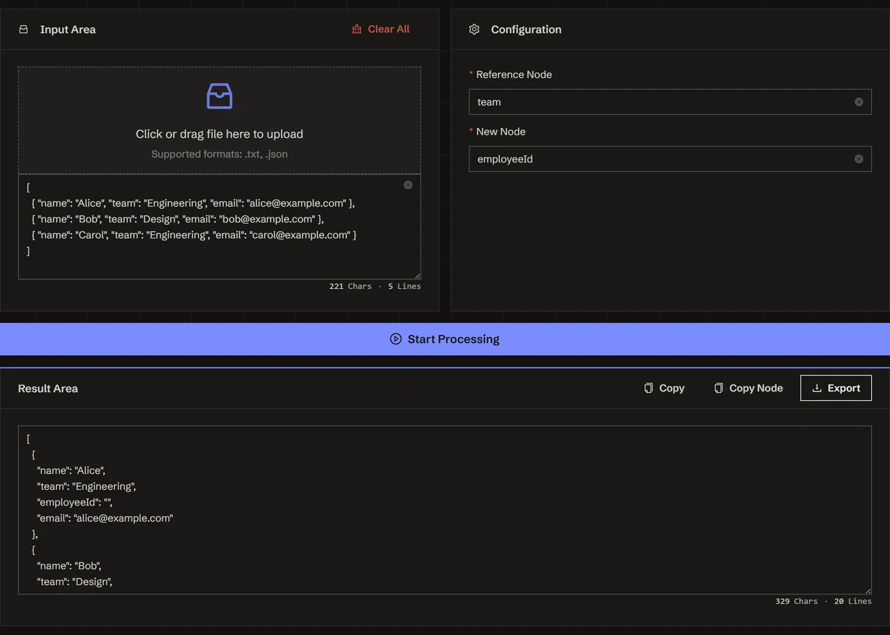

> For AI agents: the complete documentation index is available at /en/llms.txt, the full documentation bundle is available at /en/llms-full.txt.

# JSON Node Inserter

[JSON Node Inserter Tool](https://tools.newzone.top/en/json-node-inserter) is an efficient tool for optimizing data structures. It allows you to insert one or more new fields after a specified field in a JSON document, making the data structure more logical and efficient.

## Features

- Precisely insert multiple new fields after a specified field.
- Candidate field quick-pick chips: automatically parses fields from input JSON for one-click selection.
- Support for inserting multiple fields, separated by commas (supports both English and Chinese commas).
- Batch insertion of fields to improve data processing efficiency.

## How to Use

1. **Input JSON Data**
   - Drag and drop to upload a JSON or text file.
   - Or directly paste the JSON content into the text box.
   - For large JSON files, upload the file instead of pasting it.

2. **Set Insertion Parameters**
   - **Reference Field**: Enter the reference field name (where you want to insert new fields after), or click a quick-pick chip below.
   - **Insert New Field**: Enter the names of the fields to be inserted, separated by commas.

3. **Processing and Export**
   - Click the "Start Processing" button to execute the insertion.
   - The processed result will be displayed in the text area below.
   - You can choose to copy the full result, copy only the node values, or download the processed file.

## Usage Tips

- Ensure that the input JSON format is correct; otherwise, it cannot be processed.
- The reference field must exist in the JSON; otherwise, an error will be displayed.
- New fields will be inserted in the order they are entered, immediately after the reference field.
- If the field names are purely numeric, they will be automatically sorted by value and placed at the front.
- For large JSON files, upload the file instead of pasting it — the page stays responsive.

## Use Cases

- Optimize JSON configuration file structure.
- Adjust API response data format.
- Batch add new attributes to existing data structures.
- Quickly reorder system configuration parameters.
