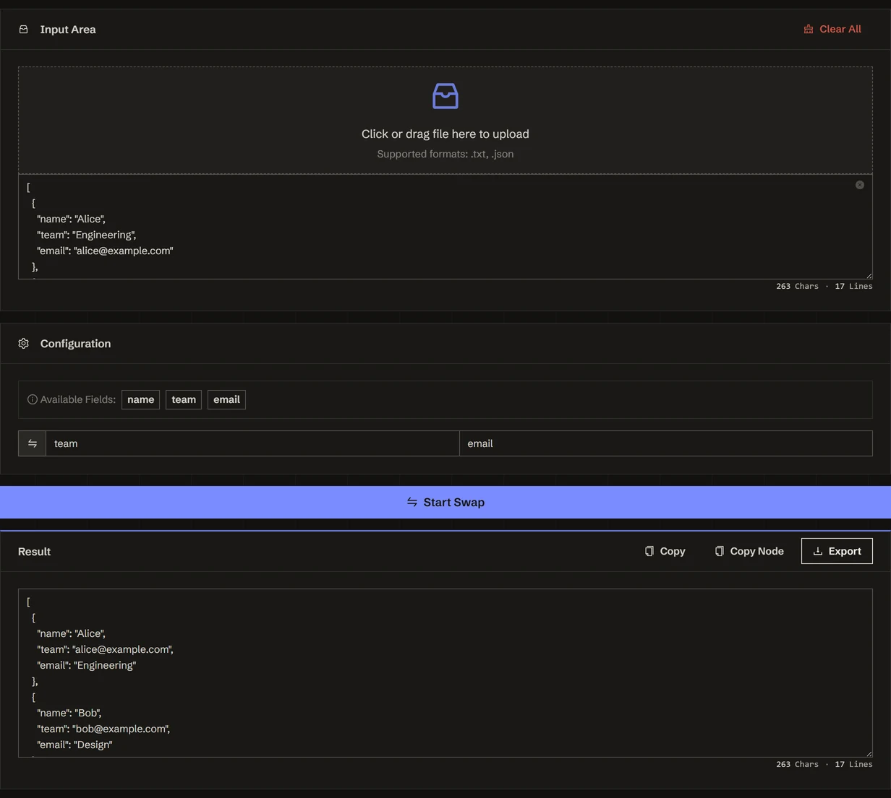

> For AI agents: the complete documentation index is available at /en/llms.txt, the full documentation bundle is available at /en/llms-full.txt.

# JSON Value Swapper

The [JSON Value Swapper Tool](https://tools.newzone.top/en/json-value-swapper) can automatically swap the values of two specified fields in a JSON array, making your data processing more convenient.

## Features

- Automatically detects and displays all available field names in the JSON.
- Swaps the values of two top-level fields in each object of a JSON array.

## Usage Steps

1. **Input JSON Data**:
   - **Upload File**: Drag and drop a file containing a JSON array into the upload area, or click to select a file (supports .json and .txt formats).
   - **Paste Data**: Directly paste your JSON array data into the text box.

2. **Select the Fields to Swap**:
   - The system will automatically analyze your data and display all available field names.
   - Click on the displayed field name button to quickly select, or type into the "Swap Fields 1" and "Swap Fields 2" inputs.
   - The values corresponding to these fields will be swapped during the processing.

3. **Execute the Swap Operation**:
   - Click the "Start Swap" button to process the data.
   - If some objects are missing the specified fields, the system will display a prompt.

4. **Manage Results**:
   - After the swap is complete, the result will be displayed in the lower section.
   - You can:
     - Copy the complete result to the clipboard.
     - Copy the JSON nodes without wrappers.
     - Export the result as a JSON file, with the filename automatically appended with a timestamp.

## Advanced Options

- **Reset**: Clears all uploaded files, input content, and results.
- **Large-file friendly**: when processing large JSON data, upload the file instead of pasting it.

## Notes

- This tool only supports swapping top-level field values of objects in a JSON array and does not support swapping fields in nested objects.
- JSON field names are case-sensitive, so please ensure the correct field names are entered.
- If some objects in the array are missing the specified fields, the system will continue processing and provide a prompt.
- It is recommended to back up your original data before processing important data.
- Ensure your JSON format is correct, as the tool can only process valid JSON data.

With this simple and easy-to-use tool, you can quickly swap field values in a JSON array, saving time on data processing and boosting your work efficiency.
