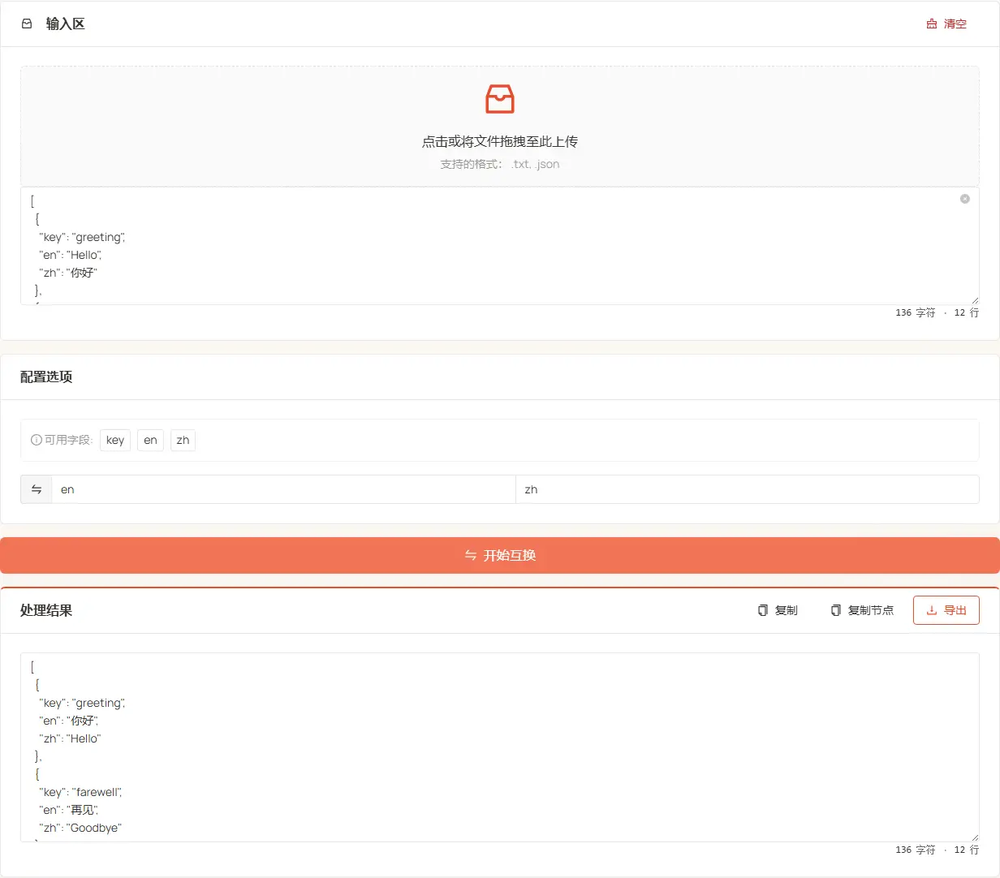

> For AI agents: the complete documentation index is available at /llms.txt, the full documentation bundle is available at /llms-full.txt.

# JSON 字段值互换

[JSON 字段值互换工具](https://tools.newzone.top/zh/json-value-swapper) 可以自动交换 JSON 数组中两个指定字段的值，让你的数据处理变得更加便捷。

## 功能特点

- 自动检测并显示 JSON 中所有可用的字段名
- 交换 JSON 数组对象中两个字段的值

## 使用步骤

1. **输入 JSON 数据**：
   - **上传文件**：将包含 JSON 数组的文件拖放到上传区域，或点击选择文件（支持 .json 和 .txt 格式）
   - **粘贴数据**：直接在文本框中粘贴你的 JSON 数组数据

2. **选择要交换的字段**：
   - 系统会自动分析你的数据并显示所有可用的字段名
   - 点击显示的字段名按钮快速选择，或在输入框中手动输入"交换字段 1"和"交换字段 2"
   - 这两个字段的值将在处理过程中被互相交换

3. **执行交换操作**：
   - 点击"开始交换"按钮处理数据
   - 如果某些对象缺少指定的字段，系统会显示提示信息

4. **管理结果**：
   - 交换完成后，结果将显示在下方区域
   - 你可以：
     - 复制完整结果到剪贴板
     - 复制不带包装的 JSON 节点
     - 导出为 JSON 文件，文件名会自动添加时间戳

## 高级选项

- **重置**：清除所有已上传文件、输入内容和结果
- **大文件友好**：处理较大的 JSON 数据时改用文件上传，避免文本框渲染拖慢页面

## 注意事项

- 本工具仅支持交换 JSON 数组中对象的顶层字段值，不支持嵌套对象中深层字段的交换
- JSON 字段名区分大小写，请确保输入正确的字段名
- 如果数组中的部分对象缺少指定的字段，系统会继续处理并给出提示
- 在处理重要数据前，建议先备份原始数据
- 确保你的 JSON 格式正确，工具只能处理有效的 JSON 数据

通过这个简单易用的工具，你可以快速交换 JSON 数组中的字段值，节省数据处理时间，提高工作效率。
